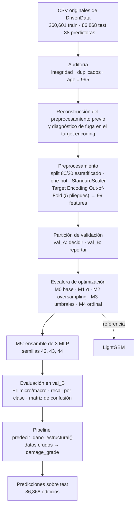

# Predicción de daño estructural post-terremoto — Richter's Predictor

Clasificación del nivel de daño de 260,601 edificaciones afectadas por el terremoto de Gorkha
(Nepal, 2015) con un **ensamble de redes neuronales MLP**, desde la auditoría de los datos hasta un
pipeline de predicción reproducible.

**Universidad de La Sabana** · Analítica y Ciencia de Datos · Fundamentos de Redes Neuronales —
Proyecto integrador, Unidad 3

**Equipo:** Ana Ferrer · Sofía Nuñez · Valentina Ramírez

| Modelo final (M5) | F1 micro | F1 macro | Recall daño bajo | Log-loss |
|---|---:|---:|---:|---:|
| Ensamble de 3 MLP (64, 32), evaluado en val_B (26,061 edificios no usados para decidir) | **0.7429** | **0.6901** | **0.5145** | **0.5748** |

---

## Contenido

1. [Contexto y objetivo](#1-contexto-y-objetivo)
2. [Dataset](#2-dataset)
3. [Metodología](#3-metodología)
4. [Modelo final](#4-modelo-final)
5. [Resultados](#5-resultados)
6. [Comparación experimental M0–M5](#6-comparación-experimental-m0m5)
7. [Pipeline integrado](#7-pipeline-integrado)
8. [Estructura del repositorio](#8-estructura-del-repositorio)
9. [Instalación y ejecución](#9-instalación-y-ejecución)
10. [Reproducibilidad](#10-reproducibilidad)
11. [Limitaciones y trabajo futuro](#11-limitaciones-y-trabajo-futuro)
12. [Equipo](#12-equipo)

---

## 1. Contexto y objetivo

El 25 de abril de 2015 un sismo de magnitud 7.8 con epicentro en Gorkha dejó cerca de 9,000
víctimas y dañó o destruyó más de 600,000 estructuras. Después de un evento así no es posible
inspeccionar todas las viviendas a la vez: estimar qué tan dañada quedó cada una ayuda a
**priorizar inspecciones y a dirigir recursos de reconstrucción**.

**Pregunta:** ¿se puede predecir el nivel de daño estructural de un edificio —bajo, medio o casi
total— a partir de sus características constructivas, sus materiales y su ubicación?

- Variable objetivo: `damage_grade` (1 = daño bajo, 2 = daño medio, 3 = daño casi total), ordinal.
- Métrica principal: **F1 micro**, la oficial de la competencia. Se acompaña de F1 macro, recall y
  precisión de la clase 1 y log-loss, porque las clases están desbalanceadas.
- Los resultados describen asociaciones en los datos de 2015, no relaciones causales.

## 2. Dataset

**Fuente oficial:** [Richter's Predictor: Modeling Earthquake Damage](https://www.drivendata.org/competitions/57/nepal-earthquake/)
(DrivenData), con datos de encuestas de Kathmandu Living Labs y la Central Bureau of Statistics de
Nepal. Los datos no se incluyen en el repositorio: ver [data/README.md](data/README.md).

| Archivo | Filas | Columnas | Contenido |
|---|---:|---:|---|
| `train_values.csv` | 260,601 | 39 | `building_id` + 38 predictoras |
| `train_labels.csv` | 260,601 | 2 | `building_id`, `damage_grade` |
| `test_values.csv` | 86,868 | 39 | sin etiqueta (se evalúa en DrivenData) |

**38 predictoras en cinco grupos:** 3 geográficas jerárquicas (31, 1,414 y 11,595 zonas),
5 numéricas (pisos, edad, área y altura relativas, familias), 8 categóricas anonimizadas
(cimentación, techo, pisos, posición, planta, tenencia, terreno) y 22 binarias (materiales de la
superestructura y usos secundarios). Detalle en [docs/data_dictionary.md](docs/data_dictionary.md).

**Distribución de clases:**

| Clase | Edificios | % |
|---|---:|---:|
| 1 · daño bajo | 25,124 | 9.64 |
| 2 · daño medio | 148,259 | 56.89 |
| 3 · daño casi total | 87,218 | 33.47 |

Predecir siempre "daño medio" ya da F1 micro 0.569, pero F1 macro de solo 0.242.

**Consideraciones sobre los datos** (verificadas en el notebook):

- Sin nulos y sin `building_id` repetidos; train y test no comparten edificios.
- `age = 995` es un código especial, no una edad (1,390 filas): se trata con una bandera.
- 16,191 filas repiten el perfil de otra en las 38 predictoras y en 3,825 de esos perfiles hay
  etiquetas distintas: existe un **error irreducible** con estas variables.
- Test no tiene deriva relevante frente a train (máximo 0.28 pp) y solo el 0.38 % de sus filas
  tiene una zona `geo_level_3_id` no vista en entrenamiento.

## 3. Metodología



1. **Auditoría.** Integridad de archivos, tipos, rangos, duplicados y valores especiales.
2. **Preprocesamiento.** El equipo partía de un dataset ya procesado. Se reconstruyó cada
   transformación desde los CSV (coincidencia ≤ 4e-15) y se descubrió una **fuga de información**:
   el target encoding de `geo_level_2_id` y `geo_level_3_id` codificaba cada fila de train con una
   media que incluía su propia etiqueta (correlación 1.0 en zonas con un solo edificio).
3. **Target Encoding Out-of-Fold.** Cada fila de train se codifica con los estadísticos de los
   otros 4 pliegues; validación y test usan los de todo train. Con la misma red, la brecha
   F1 train−val bajó de 0.0188 a 0.0018.
4. **Protocolo.** Validación (20 %) se divide en val_A, para early stopping y elecciones, y val_B,
   solo para reportar.
5. **Optimización.** Una intervención a la vez sobre el mejor modelo aceptado (M0 → M5).
6. **Evaluación e integración.** Métricas en val_B, análisis de errores, referencia LightGBM,
   pipeline de extremo a extremo y predicción sobre test.

Detalle en [docs/methodology.md](docs/methodology.md).

## 4. Modelo final

**M5 — ensamble de tres redes neuronales.**

| Elemento | Valor |
|---|---|
| Red | `sklearn.neural_network.MLPClassifier` |
| Capas ocultas | (64, 32), activación ReLU, salida softmax de 3 clases |
| Optimizador | Adam, tasa de aprendizaje 1e-3, lotes de 200 |
| Regularización | L2 con α = 1e-5 (elegido en M1) |
| Entrenamiento | `partial_fit` época a época; se conserva la época con menor log-loss en val_A (paciencia 8, máximo 80) |
| Ensamble | 3 redes con semillas 42, 43 y 44; se promedian las probabilidades y se predice la clase de mayor probabilidad |
| Entrada | 99 features con target encoding OOF |

**Por qué M5.** Es el único paso posterior a M1 que mejora todas las métricas de val_B a la vez
(F1 micro, F1 macro, recall y precisión de la clase 1 y log-loss) sin abrir brecha entre train y
validación. Promediar redes con distinta inicialización reduce la varianza de una sola red; su
efecto más claro es una log-loss menor (mejores probabilidades). El costo es ~2.7 veces el tiempo
de entrenamiento de una red.

## 5. Resultados

Métricas del modelo final en **val_B** (26,061 edificios que no se usaron para ninguna decisión),
tomadas de la ejecución original del notebook (Tabla T17):

| Métrica | Valor | Qué significa |
|---|---:|---|
| F1 micro | **0.7429** | Acierta el nivel de daño en el 74.3 % de los edificios (métrica oficial). |
| F1 macro | **0.6901** | Promedio por clase; más bajo porque la clase minoritaria se predice peor. |
| Recall clase 1 | **0.5145** | Identifica 51 de cada 100 edificios con daño bajo; el resto los asigna casi siempre a daño medio. |
| Precisión clase 1 | **0.6852** | Cuando predice daño bajo, acierta el 68.5 % de las veces. |
| Log-loss | **0.5748** | Calidad de las probabilidades; la mejor de la escalera. |
| Brecha F1 train − val_B | **−0.0002** | Sin sobreajuste. |

Por clase: recall 0.51 / 0.84 / 0.64 y precisión 0.69 / 0.74 / 0.75 (clases 1 / 2 / 3). Casi
todos los errores son entre clases vecinas; confundir daño bajo con casi total ocurre en el 0.28 %
de los edificios.

**Referencia no neuronal.** Un LightGBM con las mismas 99 features obtiene F1 micro 0.7474 y
recall de la clase 1 de 0.5404: solo 0.0045 por encima de M5. Que dos familias de modelos tan
distintas lleguen al mismo nivel indica que el límite está en la información del cuestionario más
que en la capacidad del modelo.

**Pipeline.** Aplicado a 2,000 filas de validación desde los datos crudos, el pipeline obtuvo
F1 micro 0.7405, coherente con el 0.7429 de val_B (la diferencia está dentro del ruido de
muestreo de 2,000 filas). Sobre test generó 86,868 predicciones.

> **Verificación.** Todas las cifras de esta sección se contrastaron con las salidas del notebook.
> El modelo serializado del repositorio es un reentrenamiento con la misma receta y obtiene
> F1 micro 0.7426 (diferencia −0.0003 por el entorno de ejecución). Ver
> [docs/results.md](docs/results.md), que también lista las discrepancias encontradas en los
> entregables.

## 6. Comparación experimental M0–M5

| Paso | Intervención | F1 micro | F1 macro | Recall c1 | Log-loss | Decisión |
|---|---|---:|---:|---:|---:|---|
| M0 | Base limpia con TE OOF, α = 1e-4 | 0.7403 | 0.6824 | 0.4934 | 0.5801 | base |
| M1 | Búsqueda de α → 1e-5 | 0.7415 | 0.6863 | 0.5066 | 0.5788 | aceptado |
| M2 | Oversampling ×2 de la clase 1 | 0.7256 | 0.6887 | **0.7449** | 0.6065 | descartado |
| M3 | Umbrales ordinales | 0.7413 | 0.6830 | 0.4851 | 0.5788 | sin mejora |
| M4 | Ordinal: dos sigmoides acumuladas | 0.7411 | 0.6846 | 0.4950 | 0.5825 | sin mejora |
| **M5** | **Ensamble de 3 semillas** | **0.7429** | **0.6901** | **0.5145** | **0.5748** | **final** |

Métricas en val_B; las decisiones se tomaron con F1 micro en val_A.

- **M2 (oversampling)** sube el recall del daño bajo de 0.51 a 0.74, pero baja la precisión de esa
  clase a 0.53 y el F1 micro a 0.7256: gana unos 600 aciertos de daño bajo y pierde unos 1,000 en
  las otras clases. Se descarta porque empeora el desempeño global.
- **M3 (umbrales)**: el mejor par de umbrales para F1 micro es (0.50, 0.50), equivalente al argmax.
- **M4 (ordinal)** empata con M1 y empeora la log-loss.
- La mejora total M0 → M5 (+0.0026 de F1 micro) es del orden del error estándar en val_B
  (≈ 0.0027). La conclusión sólida es que ni la regularización ni los umbrales son palancas
  relevantes y que el ensamble mejora la calidad de las probabilidades.

Detalle y lectura de cada paso en [docs/model_experiments.md](docs/model_experiments.md).

## 7. Pipeline integrado

```python
import pandas as pd
from richter_predictor.pipeline import predecir_dano_estructural

datos_nuevos = pd.read_csv("data/raw/test_values.csv")
predicciones = predecir_dano_estructural(datos_nuevos)
print(predicciones.head(3))
#    building_id  damage_grade
# 0       300051             3
# 1        99355             2
# 2       890251             2
```

- **Recibe** un `DataFrame` con las 39 columnas de `test_values.csv` (`building_id` y las 38
  predictoras originales).
- **Valida** la estructura: columnas faltantes, nulos, tipos, binarias fuera de {0, 1}, valores
  negativos, ids repetidos y categorías desconocidas producen un `EntradaInvalidaError` con un
  mensaje que indica el problema.
- **Transforma** con los parámetros ajustados en train (guardados en
  `artifacts/models/preprocesador_m5.json`): imputación y bandera de `age = 995`, escalado,
  one-hot y target encoding, en el orden exacto de las 99 features.
- **Predice** con el ensamble M5 (`artifacts/models/ensamble_m5.joblib`) y **devuelve**
  `building_id` y `damage_grade` ∈ {1, 2, 3}. Con `devolver_probabilidades=True` agrega
  `p_1`, `p_2`, `p_3`.

No depende de variables del notebook y aplica exactamente la misma transformación a validación y
a test. Más detalle en [docs/pipeline.md](docs/pipeline.md).

## 8. Estructura del repositorio

```text
richter-predictor-nepal/
├── README.md
├── CONTRIBUTING.md               # ramas y reglas de colaboración
├── LICENSE                       # MIT (código y documentación, no los datos)
├── requirements.txt              # versiones fijadas y verificadas
├── pyproject.toml                # paquete instalable richter_predictor
├── data/
│   ├── README.md                 # cómo obtener y ubicar los datos
│   ├── raw/                      # CSV de DrivenData (no versionados)
│   └── processed/                # metadata del preprocesamiento (versionado) y parquet (no)
├── notebooks/
│   ├── proyecto_integrador_richter.ipynb   # notebook consolidado de las tres partes, con salidas
│   └── antecedentes/actividad5_modelo_base.ipynb
├── src/richter_predictor/
│   ├── config.py                 # rutas, columnas, semillas e hiperparámetros
│   ├── data_loader.py            # lectura y verificación de los CSV
│   ├── preprocessing.py          # split, target encoding OOF y transformación a 99 features
│   ├── model.py                  # early stopping, ensamble M5, guardado y carga
│   ├── evaluation.py             # val_A/val_B y métricas
│   ├── pipeline.py               # predecir_dano_estructural()
│   ├── train.py                  # python -m richter_predictor.train
│   └── predict.py                # python -m richter_predictor.predict
├── artifacts/
│   ├── README.md                 # procedencia de los artefactos
│   ├── models/                   # ensamble_m5.joblib, preprocesador_m5.json, metricas_m5.json
│   └── predictions/              # submission_M5.csv (86,868 filas)
├── reports/
│   ├── README.md
│   ├── informe_tecnico_final.docx
│   ├── figures/                  # 12 figuras del notebook
│   ├── tables/                   # 22 tablas de resultados
│   └── antecedentes/             # informe de la Actividad 5
├── docs/
│   ├── methodology.md · data_dictionary.md · model_experiments.md
│   ├── pipeline.md · results.md · team_contributions.md
├── presentation/
│   ├── README.md
│   └── presentacion_ejecutiva.pptx
├── scripts/
│   └── extraer_tablas_notebook.py
└── tests/                        # 32 pruebas (pytest)
```

**Sobre el notebook.** El notebook consolidado no se dividió en tres: las Partes 2 y 3 usan objetos
creados en la Parte 1 (`transformar()`, estadísticos del encoding), y separarlo rompería su
ejecución o duplicaría código. Se conserva completo, con las salidas originales. Las funciones reutilizables se extrajeron a `src/` sin cambiar su
comportamiento.

## 9. Instalación y ejecución

Requisitos: Python 3.11 (verificado con 3.11.9) y Git.

### 9.1 Clonar e instalar

```bash
git clone https://github.com/<usuario>/richter-predictor-nepal.git
cd richter-predictor-nepal

python -m venv .venv
# Windows
.venv\Scripts\activate
# Linux / macOS
source .venv/bin/activate

python -m pip install --upgrade pip
pip install -r requirements.txt
pip install -e .
```

### 9.2 Ubicar los datos

Descargar de DrivenData `train_values.csv`, `train_labels.csv`, `test_values.csv` y
`submission_format.csv` y copiarlos en `data/raw/` (ver [data/README.md](data/README.md)).
El pipeline de inferencia y la mayoría de las pruebas funcionan sin estos archivos.

### 9.3 Ejecutar las pruebas

```bash
python -m pytest
```

Resultado verificado: `32 passed` con los datos en `data/raw/`; `29 passed, 3 skipped` sin ellos.

### 9.4 Predecir con el modelo entrenado

```bash
python -m richter_predictor.predict --entrada data/raw/test_values.csv --salida artifacts/predictions/submission_M5.csv
```

O desde Python con `predecir_dano_estructural()` (sección 7). No requiere reentrenar.

### 9.5 Reentrenar el modelo M5

```bash
python -m richter_predictor.train
```

Tarda unos 5 minutos en un portátil. Reescribe `artifacts/models/` e imprime las métricas en
val_B junto a las del notebook.

### 9.6 Ejecutar el notebook completo

Necesita además `data/processed/terremoto_train_procesado.parquet` (ver data/README.md).
Se puede abrir con Jupyter o VS Code y ejecutar en orden, o desde la terminal:

```bash
python -m nbconvert --to notebook --execute --inplace notebooks/proyecto_integrador_richter.ipynb --ExecutePreprocessor.timeout=3600
```

La ejecución completa entrena toda la escalera y LightGBM (≈ 15–20 minutos) y sobrescribe
`reports/figures/`, `reports/tables/` y los archivos derivados de `data/processed/`.

## 10. Reproducibilidad

| Aspecto | Detalle |
|---|---|
| Semillas | 42 para el split, los pliegues OOF, val_A/val_B y la red base; 42, 43 y 44 para el ensamble |
| División | `train_test_split(test_size=0.2, random_state=42, stratify=damage_grade)` → 208,480 / 52,121; val → val_A 26,060 / val_B 26,061 |
| Orden de ejecución | CSV → `PreprocesadorRichter.fit_transform_oof` (train) / `transform` (val, test) → `entrenar_m5` → evaluación en val_B |
| Dependencias | `requirements.txt` con versiones fijadas (numpy 1.26.4, pandas 2.2.3, scikit-learn 1.7.2, lightgbm 4.6.0) |
| Artefactos necesarios para predecir | `artifacts/models/preprocesador_m5.json` y `ensamble_m5.joblib` (versionados) |
| Resultados esperados | `python -m richter_predictor.train` en este entorno: F1 micro val_B 0.7426, F1 macro 0.6902 (`artifacts/models/metricas_m5.json`) |

**Qué se verificó:**

- El split y el preprocesamiento de `src/` reproducen el parquet original (diferencia ≤ 4e-15).
- La matriz de entrenamiento que construye `src/` es idéntica bit a bit a la del notebook.
- El notebook adaptado se ejecutó de principio a fin en la estructura del repositorio.

**Limitaciones de reproducibilidad:**

- Con la misma entrada, semillas e hiperparámetros, el entrenamiento local no reproduce los pesos
  exactos de la ejecución en Colab (Python 3.13, versiones de librerías no registradas): las
  métricas difieren en el cuarto decimal (F1 micro 0.7426 frente a 0.7429). Las cifras oficiales
  son las del notebook original.
- El modelo original de Colab y su `submission_M5.csv` no se guardaron; los del repositorio son
  reentrenamientos.
- El código que generó el parquet "congelado" histórico no se conserva; se reconstruyó y verificó
  numéricamente, pero el notebook todavía lo necesita para la auditoría de la Parte 1.
- Cada paso de la escalera se corrió con una sola semilla; las diferencias entre pasos son del
  orden del ruido de muestreo.

## 11. Limitaciones y trabajo futuro

**Limitaciones**

- **Clase de daño bajo.** El recall de la clase 1 es 0.51: casi la mitad de los edificios con daño
  bajo se clasifican como daño medio. En test, el modelo predice 7.3 % de daño bajo frente al
  9.6 % de train y sobrerrepresenta la clase media (+7.8 pp).
- **Techo de información.** Hay perfiles idénticos con etiquetas distintas y el cuestionario no
  recoge calidad de la obra, tipo de suelo ni intensidad sísmica local. LightGBM queda solo 0.0045
  por encima.
- **Generalización.** El modelo describe el sismo de Gorkha de 2015. Depende de identificadores
  geográficos propios de ese evento y no se validó en otros sismos ni regiones.
- **Evaluación en test.** Test no tiene etiquetas; su desempeño solo puede medirse con un envío a
  DrivenData, que no se hizo.

**Trabajo futuro**

- Ponderar clases o usar *focal loss* en la función de pérdida en lugar de remuestrear.
- Un clasificador jerárquico (daño bajo frente al resto, luego medio frente a casi total).
- Incorporar información externa de suelo o intensidad sísmica por zona, si existe una fuente
  compatible con los identificadores geográficos.
- Repetir la escalera con varias semillas para estimar la variabilidad de cada paso.
- Monitorear la distribución de clases predichas en cada reentrenamiento.

## 12. Equipo

| Integrante | Responsabilidad principal |
|---|---|
| **Sofía Nuñez** | Parte 1: planteamiento del problema, auditoría de datos, preprocesamiento, diagnóstico de la fuga del target encoding y propuesta OOF, análisis exploratorio. |
| **Ana Ferrer** | Parte 2: protocolo val_A/val_B, entrenamiento con early stopping, escalera de optimización M0–M5 y referencia LightGBM. |
| **Valentina Ramírez** | Parte 3: evaluación del modelo final, análisis de errores, pipeline integrado, predicción sobre test y conclusiones. |

Las tres integrantes construyeron el proyecto en conjunto y firman el informe y la presentación.
Detalle y decisiones de equipo en [docs/team_contributions.md](docs/team_contributions.md).

**Entregables:** informe técnico ([reports/informe_tecnico_final.docx](reports/informe_tecnico_final.docx);
PDF pendiente) y presentación ejecutiva ([presentation/](presentation/); video pendiente).
