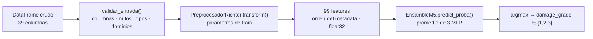

# Pipeline de inferencia

## Interfaz

```python
import pandas as pd
from richter_predictor.pipeline import predecir_dano_estructural

datos_nuevos = pd.read_csv("data/raw/test_values.csv")
predicciones = predecir_dano_estructural(datos_nuevos)
#    building_id  damage_grade
# 0       300051             3
# 1        99355             2
```

`predecir_dano_estructural(df_crudo, modelo=None, preprocesador=None, devolver_probabilidades=False)`

| Parámetro | Descripción |
|---|---|
| `df_crudo` | `DataFrame` con las 39 columnas de `test_values.csv` (`building_id` + 38 predictoras). Se ignoran columnas adicionales y el orden de columnas no importa. |
| `modelo`, `preprocesador` | Opcionales. Por defecto se cargan una sola vez desde `artifacts/models/` (`ensamble_m5.joblib` y `preprocesador_m5.json`). |
| `devolver_probabilidades` | Si es `True`, agrega `p_1`, `p_2`, `p_3` (probabilidades promedio del ensamble). |

Devuelve un `DataFrame` con `building_id` y `damage_grade` (entero 1, 2 o 3), una fila por
edificio y en el mismo orden de la entrada.

Desde la línea de comandos:

```bash
python -m richter_predictor.predict --entrada data/raw/test_values.csv --salida artifacts/predictions/submission_M5.csv
```

## Pasos internos



1. **Validación** (`validar_entrada`). Rechaza con `EntradaInvalidaError` y un mensaje explícito:
   objetos que no son `DataFrame`, tablas vacías, columnas faltantes, nulos, `building_id`
   repetidos, valores no enteros en columnas enteras, binarias distintas de 0/1, numéricas
   negativas y categorías de baja cardinalidad que no existen en entrenamiento (codificarlas como
   "todo ceros" produciría una entrada que el modelo nunca vio).
2. **Transformación** (`PreprocesadorRichter.transform`), con parámetros ajustados solo con train:
   - `age = 995` → mediana de train (15) y bandera `age_valor_especial_995`;
   - StandardScaler de las 5 numéricas con media y desviación de train;
   - one-hot de las 8 categóricas y `geo_level_1_id` con las categorías de train;
   - target encoding de `geo_level_2_id` y `geo_level_3_id` con los estadísticos de todo train
     (m = 15) y la escala del TE OOF; zonas no vistas reciben la media global (2.2383);
   - 22 binarias sin cambios.
   Las 99 columnas se ordenan como en `feature_cols` del metadata.
3. **Predicción**. Cada red da probabilidades para las clases 1, 2 y 3; se promedian y la clase
   final es la de mayor probabilidad.

## Garantías y diferencias con el notebook

- La transformación es la misma para validación y test: no se ajusta nada con los datos de
  entrada, así que una fila se predice igual sola que dentro de un lote (lo comprueba
  `tests/test_pipeline.py::test_consistencia_por_lotes_y_fila_a_fila`).
- En el notebook, `predecir_dano_estructural` dependía de variables en memoria (`modelo_M5`,
  `transformar`, `te_reconstruido`, `escalado_oof`, `num_todo`, `es_train`). En el paquete esos
  parámetros viven en `artifacts/models/preprocesador_m5.json` y el modelo en
  `ensamble_m5.joblib`.
- La validación de entrada es nueva. Sobre los datos reales no cambia ninguna predicción: test no
  tiene categorías nuevas de baja cardinalidad y las zonas geo nuevas se tratan igual que antes.

## Regenerar los artefactos

```bash
python -m richter_predictor.train
```

Lee `data/raw/train_values.csv` y `train_labels.csv`, ajusta el preprocesamiento, entrena las
tres redes (≈ 5 minutos en un portátil) y escribe en `artifacts/models/` el preprocesador, el
ensamble y `metricas_m5.json` con las métricas de val_A y val_B comparadas con el notebook.
